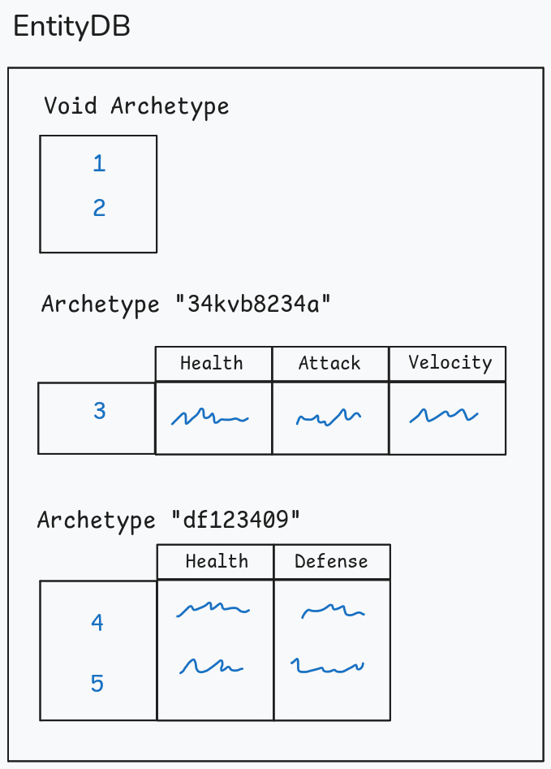
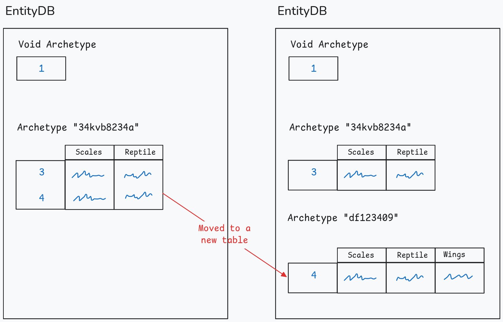
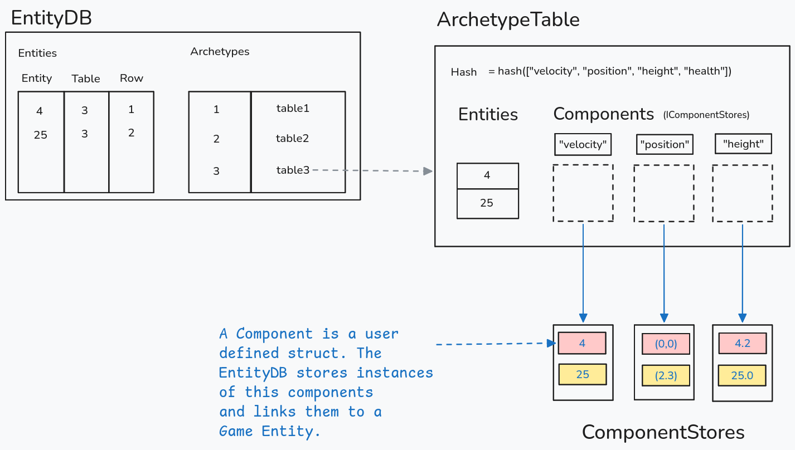

<h1 align="center">Delinquent Cupid🏓</h1>
<p align="center">A game where you have to "breakout" waves of people declare to your crush❤️ <br/> made in Zig with Raylib + ImGui</p>


**Controls 🖲️:**\
Your mouse 🐁

**Tested with**
- Zig `0.16.0`
- ImGui `1.92.1-docking`
- Raylib `6.0.0`
- rlimgui `commit dc7f97679a024eee8f5f009e77cc311748200415`

[**▶️ Watch the DEMO**](https://youtu.be/z-iqwpSnDVA)

## How I got it to work...
At the time of writing this, zig is still in beta, so everything is subject to change. Inspired by the work of schmee in [zig-raylib-imgui-template](https://github.com/schmee/zig-raylib-imgui-template) for zig 0.13, I did the same setup for zig 0.16.0. 

```
  Raylib ◄────── rlimgui  ◄────── ImGui
(dynamically                           
  linked)                              
     │                                 
     │                                 
     ▼                                 
 Executable                            
   (LLVM)                              
```

ImGui and Raylib are not meant to work together, so some _glue code_ (provided by `rlimgui`) is required to allow ImGui to communicate with the backend provided by Raylib (GLFW). 

Also, the Raylib library is actually *dynamically linked* and everything is compiled with LLVM, due to some problems with my OS (Manjaro) at the time of building this project 😅.

## How to run it 

``` bash
zig build         # Compile
zig build run     # Compile & run
zig build test    # Run tests
```

## Architecture

The architecture is heavily inspired by the drafts provided in [a post written by the creators of the Mach engine](https://devlog.hexops.org/2022/lets-build-ecs-part-1/). The whole idea revolves around 2 main pillars: 

1. See the ECS as a **Relational DB** with some sprinkles✨ on top.
2. The data should be as **tightly** packed as possible.

Those two directed the main design decisions and data structures, resulting in:

- A **Game** is just a set of **Scenes**. 
- A **Scene** is composed of **Systems** and an **EntityDB**.
  - An **EntityDB** is a light Relational DB storing **Components** for each **Entity**.
  - A **System** is a set of callbacks that controls the behaviour of a set of entities.


A diagram might help :D! Here are the Top-level structures:


If we go deep into a **Scene** we will find an **EntityDB**, which works SUPER similar to a relational database, with the difference that **tables (Archetypes) are created on the fly**, and rows are moved around them automatically.

**Why, you ask?**

It's a memory optimization. The closer a set of items are in memory, the less round trips the CPU requires to read them, and the less space they take. In our context, it means that **entities with the same combination of components should be stored together**, that is: *entities with the same schema should be stored on the same archetype. ('Archetype' and 'Table' are equivalent)*.

<p align="center">

</p>

Whenever you add/remove a component to an entity, you are changing its "archetype": If you add wings to a lizard 🦎 it's no longer a lizard, IT'S A DRAGON 🐲! So to prevent mixing lizards with dragons, we create a new archetype in the DB automatically, and move the entity there, as shown below.




**Then, why the cryptic Archetype names?**

Because they are hashes, **an Archetype name is the hash of its components' names**. This design allows querying entities of any schema SUPER FAST: if you look for entities with only "scales", "reptiles" and "wings", you just have to compute their hash and check if a table with the same name exists; if it does, you are guaranteed that all its rows have those exact 3 components, basically O(1).

If you query for items non-strictly (they can have more components than requested), you will have to ask each table if it has the components you are looking for; if they do, return all rows of that table, basically O(n).

### The Implementation
An Entity DB is composed of lots of arrays (to keep data as close as possible, remember?). Simply speaking:

1. A **Component Store** is an array of components of the same type.
2. An **Archetype Table** stores an array hashmap of **Component Stores** which act as columns.
3. BUT, since we don't know the column types in advance, we need to make them generic through the *IComponentStore* interface, so any table can have columns of any type.
4. The **Archetype Table** stores the list of entities it owns in the `Entities` array.
5. The **EntityDB** stores an array hashmap of **Archetype tables** where the key is each table's hash.
6. The **EntityDB** stores an array hashmap of **Entities**, where the key is an entity ID, and the value is the index of the table and the row where it currently lives.




## Debugging tools
The debugging tools were also a challenge. They provide a direct way to interact with all the structures mentioned before WHILE THE GAME IS RUNNING.

Imagine you have a `position` component:
```c
const position = struct {
  x : i32 = 0;
  y : i32 = 0;
  z : i32 = 0;
}
```
If you were to edit the values of this struct at runtime, you would need to know its fields, sizes and offsets, but since the type is erased when storing in IComponentStores (as mentioned on `Implementation`), it's no longer possible after compilation to cast them back so easily (the notion of `type` doesn't exist at runtime).

### The Solution
Store the necessary type info in a `TypeDescriptor` struct before compilation ends. Whenever we need to edit a component at runtime, we just check this struct, which tells us all we need to know about that type. Check `./src/ecs/reflect.zig` for more info. 