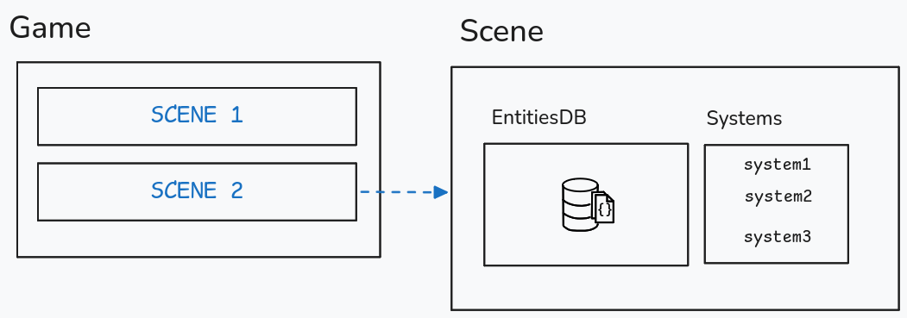

<h1 align="center">Zing Zong</h1>

A Breakout game implementation in Zig with Raylib + ImGui

Tested with 
- Zig `0.16.0`
- ImGui `1.92.1-docking`
- Raylib `6.0.0`
- rlimgui `commit dc7f97679a024eee8f5f009e77cc311748200415`

## How I got it to work...
At the time of writing this, zig is still on beta, so everything is subject to change, inspired in the work by schmee in [zig-raylib-imgui-template](https://github.com/schmee/zig-raylib-imgui-template) for zig 0.13, I did the same setup for zig 0.16.0. 

```
  Raylib ◄────── rlimgui  ◄────── ImGui
(dynamically                           
  linked)                              
     │                                 
     │                                 
     ▼                                 
 Executable                            
   (LLVM)                              
```

ImGui and Raylib are not meant to work together, so some _glue code_ is required by `rlimgui` to allow ImGui communicate with the backend provided by Raylib (GLFW). 

Also the Raylib library is actually *dinamically linked* and everything compiled with LLVM, due to some problems with my OS (Manjaro) at the time of building this project.

## How to run it 

``` bash
zig build           # Compile
zig build run       # Compile & run
```

## Architecture

The architecture is heavely inspired in the drafts provided [by a post written by the creators of the match engine ](https://devlog.hexops.org/2022/lets-build-ecs-part-1/). The whole idea revolves around 2 main pillars: 

1. See the ECS as **Relational DB** with some sprinkles✨ on top.
2. The data should be as **thighly** pack as possible.

Those to directed the main design decision and data structures giving returning something like this:

- A **Game** is just a set of **Scenes**. 
- A **Scene** is composed by **Systems** and a **EntityDB**.
  - A **EntityDB** is a light Relational DB storing components for each entity.
  - A *System* is just a set of callbacks r


In the end


## Debugging tools